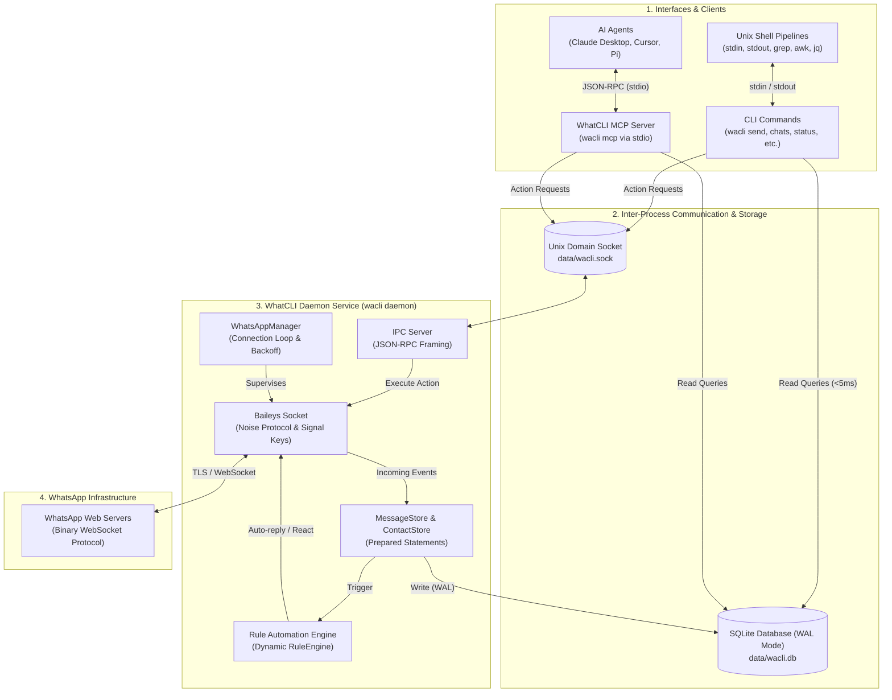
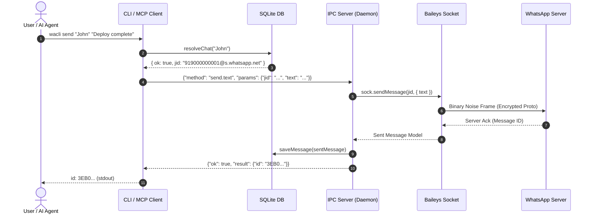
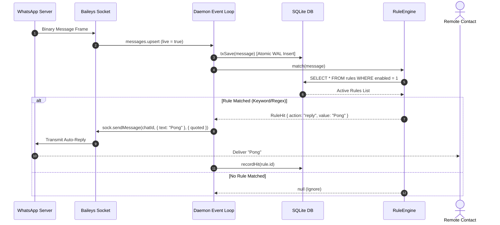
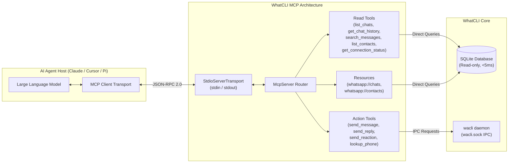
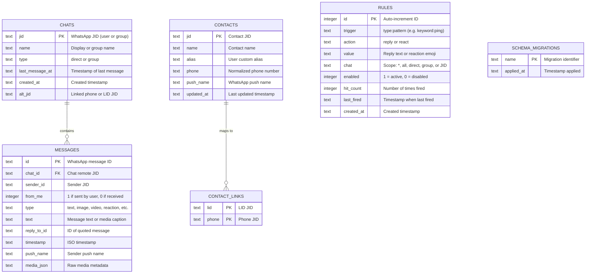
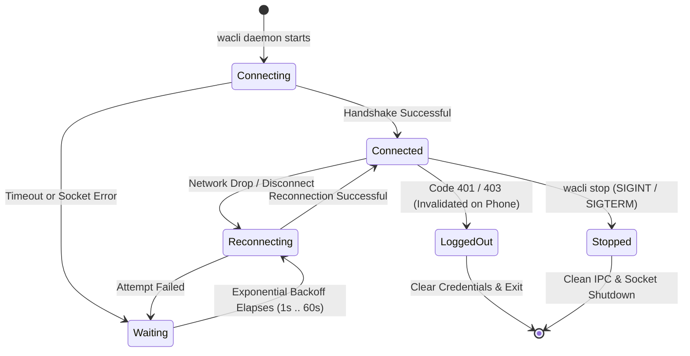

# WhatCLI Architecture Documentation

This document provides a technical overview of WhatCLI's internal architecture, data flow, IPC design, database schemas, and integration points.

---

## 1. High-Level System Architecture

WhatCLI is split into three primary tiers:
1. **Clients & Interfaces:** The standard CLI (`wacli`), shell pipelines, and the Model Context Protocol (MCP) server for AI agents.
2. **IPC & Storage Core:** A local Unix domain socket (`wacli.sock`) and an embedded SQLite database (`wacli.db`) running in Write-Ahead Logging (WAL) mode.
3. **Daemon & Network Engine:** A long-lived background service that supervises the Baileys WebSocket connection, processes real-time events, manages Signal encryption keys, and executes automation rules.



---

## 2. Core Workflows & Sequence Diagrams

### A. Message Dispatch Flow (CLI or MCP via IPC)

When a command like `wacli send` or an MCP agent sends a message:
1. The client resolves the recipient against the local SQLite database.
2. If the daemon is running, the client sends an IPC request over `wacli.sock`.
3. The daemon uses its live WebSocket to transmit and encrypt the message.
4. The message is indexed locally and the message ID is returned to stdout.



---

### B. Real-Time Incoming Message & Dynamic Automation Flow

When a new message arrives from WhatsApp:
1. Baileys decrypts the message frame and parses it.
2. The message is persisted in SQLite inside an atomic transaction.
3. The `RuleEngine` dynamically queries active rules from the database (no restarts needed).
4. If a keyword or regex rule matches, an auto-reply or reaction is dispatched automatically.



---

### C. Model Context Protocol (MCP) Architecture

WhatCLI exposes an MCP server (`src/mcp/`) that AI agents connect to over standard input/output (`stdio`):



---

## 3. Database Schema & Indexing

The embedded SQLite database utilizes WAL mode (`PRAGMA journal_mode = WAL`) and is optimized with page caching (`PRAGMA cache_size = -64000`) and lock timeouts (`PRAGMA busy_timeout = 5000`).



### Key Performance Indexes:
- `idx_chats_last_message` on `chats(last_message_at DESC)`: Powers sub-millisecond `wacli chats` queries.
- `idx_messages_chat_time` on `messages(chat_id, timestamp)`: Accelerates conversation history retrieval.
- `idx_messages_timestamp` on `messages(timestamp DESC)`: Optimizes global search and chronological scans.
- `idx_contacts_name` on `contacts(name)`: Accelerates contact name lookups and alias resolutions.

---

## 4. Connection Lifecycle & Reconnect Policy

The daemon manages the WebSocket connection using an event-driven supervisor loop:



### Policy Profiles:
- **`DAEMON_POLICY` (Daemon Mode):** Unbounded retries with exponential backoff (`delay = min(60s, 1s * 2^attempt)`). Designed to survive indefinite Wi-Fi and ISP outages without dying.
- **`DEFAULT_POLICY` (Ephemeral CLI Mode):** Caps at 8 attempts before giving up to prevent blocking the terminal indefinitely.

---

## 5. IPC Protocol Specification

Communication between CLI commands and the background daemon takes place over a local Unix domain socket (`data/wacli.sock`).

### Transport Framing
- Every message is a single line terminated by a newline (`\n`).
- The server processes messages in a streaming buffer loop to support pipelined or chunked requests without data loss.

### Request Format
```json
{
  "id": 1,
  "method": "send.text",
  "params": {
    "jid": "919000000001@s.whatsapp.net",
    "text": "Hello from CLI"
  }
}
```

### Response Format
```json
{
  "id": 1,
  "ok": true,
  "result": {
    "id": "3EB0ABC123",
    "status": "sent"
  }
}
```

### Supported IPC Methods
| Method | Parameters | Return Value | Description |
|---|---|---|---|
| `ping` | `{}` | `{ state, connectionState, connectionDetail, ingested, uptime }` | Health check & live status |
| `send.text` | `{ jid, text }` | `Message` | Transmit text message |
| `send.reply` | `{ jid, target, text }` | `Message` | Reply to message |
| `send.reaction`| `{ jid, target, emoji }` | `Message` | React with emoji |
| `send.image` | `{ jid, filePath, caption }` | `Message` | Send image file |
| `send.document`| `{ jid, filePath }` | `Message` | Send document file |
| `lookup` | `{ phone }` | `Array<{ jid, exists, lid }>` | Query number registration |
| `group.info` | `{ jid }` | `GroupInfo` | Live fetch group participants |
| `media.download` | `{ raw }` | `{ b64, mediaJson }` | Download media buffer |
| `stop` | `{}` | `{ stopping: true }` | Initiate graceful shutdown |
